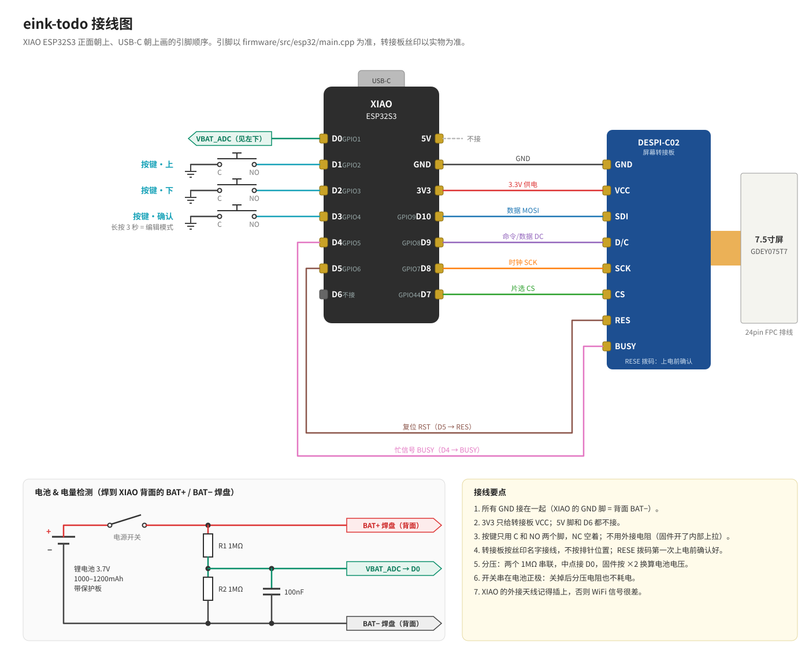

# 硬件

> 状态：选型已定（2026-10-16），**还没下单**。价格和链接下单时填。写固件前以本文件为准。
> 2026-10-16 已在模拟器和 Wokwi 里跑通整套固件，引脚分配按 Wokwi 发现的问题改过一次（见「引脚分配」）。
> 标「待核对」的是还没从规格书或实物确认的数字，别当真值用。

## 选型

| 部件 | 型号 | 购买链接 | 备注 |
|---|---|---|---|
| 开发板 | **Seeed Studio XIAO ESP32S3**（不要 Sense 版，不要 Plus 版；**必须带 8MB PSRAM**，字库整个加载进 PSRAM） | | ESP32-S3，8MB PSRAM + 8MB flash；背面有锂电池焊盘，板载充电（官方页写 100mA，有的资料写 50mA，待核对）；板级深睡约 14µA（官方数据）；11 个 GPIO（D0–D10） |
| 墨水屏 | **大连佳显 Good Display GDEY075T7**，7.5" 黑白 800×480，驱动 IC UC8179，SPI | | GxEPD2 驱动类 `GxEPD2_750_GDEY075T7`，源码标注支持快速局刷：全刷约 1.2s，局刷约 0.45s。外形 170.2×111.2×1.25mm，显示区 163.2×97.92mm，24pin FPC（卖家参数页，2026-10-16；到货实量再确认）。卖家标称：全刷 3s / 快刷 1.5s / 局刷 0.3s，工作温度 0–50℃ |
| 屏幕转接板 | **Good Display DESPI-C02**（24pin FPC 转 SPI） | | 买「屏+转接板 C02」套餐。板上有 RESE 拨动开关（升压电路采样电阻档位），**到货后、第一次上电前**自己查佳显资料/板子丝印确认档位并拨好，断电操作（档位待核对） |
| 按键 | 3 个 12mm 自复位按键（或 16mm 金属按键）。选**自复位、无灯、短款**；带灯的 LED 要额外供电且没有空余引脚，不要。只接常开（NO）和公共端（C） | | 低电平有效，用内部上拉，不需要外接电阻。装在相框底边或侧边，孩子手指好按 |
| 电池 | 3.7V 锂聚合物电池，**1000–1200mAh**，带保护板，厚度 ≤ 6mm | | 不选 2000mAh：按 100mA 充电要 20 小时以上。1000mAh 一晚上能充满 |
| 电量检测 | 2 个 1MΩ 电阻分压 + 100nF 电容 | | XIAO ESP32S3 原版没有电池电压检测引脚，要自己从 BAT+ 分压接到 ADC |
| 电源开关 | 小型拨动开关，串在电池正极 | | 可选。长期不用或寄送时断电 |
| 外壳 | 现成相框改装，内框尺寸 ≥ 屏幕外形 | | 买之前量好屏幕实物；用卡纸自制衬板，开窗对齐显示区。电路板、电池、按键装在相框背板上的小盒子里，USB-C 口露出来用来充电和刷固件 |

### 为什么这么选
- **XIAO ESP32S3**：散件方案里同时满足「有 PSRAM、有电池充电、深睡电流低、资料多」的板子。普通 ESP32 开发板带的 USB 转串口芯片、电源指示灯、AMS1117 稳压器静态电流太大，用电池撑不了几天。
- **GDEY075T7**：7.5" 黑白 800×480 里，驱动库明确支持快速局刷，而且有实测刷新时间。三色或彩色 7.5" 屏只能全刷，打勾体验太差。
- **微雪 7.5" V2 + 微雪驱动板** 可以作为替代（GxEPD2 类 `GxEPD2_750_T7`），但微雪的驱动板体积大，而且它的复位电路需要在库里做特殊处理。

## 引脚分配（草案，接线前对照 XIAO ESP32S3 官方引脚图核对）

约束条件：
- 按键要能把芯片从深度睡眠唤醒（ext1）→ 只能接 RTC GPIO（ESP32-S3 是 GPIO0–21）。
- 电量 ADC 只能接 ADC 引脚（D0–D5、D8–D10）。
- D6 / D7（GPIO43 / 44）不是 RTC 也不是 ADC 引脚，只能做普通输出。
- **D6（GPIO43）是 UART0 TX，开机时 ROM 会往上打日志，不能接屏幕信号。** 最初把屏幕 DC 接在这里，Wokwi 里 DC 一直是高电平、屏幕收不到任何命令。现在空着（2026-10-16 去掉了蜂鸣器）。
- 余量只有 D6 一个，而且只能做开机会乱跳的普通输出。以后要加 DS3231 时钟（I2C 要两根线）或更多按键，需要换引脚更多的板子。

| XIAO 引脚 | GPIO | 用途 |
|---|---|---|
| D0 | 1 | 电池电压 ADC（分压后） |
| D1 | 2 | 按键：上 |
| D2 | 3 | 按键：下 |
| D3 | 4 | 按键：确认 |
| D4 | 5 | EPD BUSY |
| D5 | 6 | EPD RST |
| D6 | 43 | 空（不接） |
| D7 | 44 | EPD CS |
| D8 | 7 | EPD SCK |
| D9 | 8 | EPD DC |
| D10 | 9 | EPD MOSI（DIN） |

另外：3V3 → 转接板 VCC，GND 共地；电池接 XIAO 背面 BAT+ / BAT- 焊盘。

## 功耗估算（理论值，样机实测后替换）

| 场景 | 估算 | 依据 |
|---|---|---|
| 深度睡眠 | 约 20–50µA，≈ 1mAh/天 | XIAO 14µA + 分压 2µA + 屏幕休眠和转接板（待测） |
| 按键唤醒 + 局刷 | 每次约 0.02mAh；每天 30 次 ≈ 0.6mAh | 约 1–2s，平均几十 mA |
| 每天 04:00 联网校时 + 全刷 | ≈ 0.2mAh | WiFi 约 5s |
| 家长编辑模式 | **每次约 10–15mAh** | WiFi 开 10 分钟；这是耗电大头 |

按每周编辑 2 次算，平均每天约 5–6mAh，1000mAh 理论能用好几个月。需求里的验收目标先定保守的 4 周。

## 接线

（源文件 `hardware/wiring.svg`，改引脚时和 `firmware/src/esp32/main.cpp` 的 `pins::` 一起改。）

| 屏幕转接板（DESPI-C02） | XIAO 引脚 |
|---|---|
| BUSY | D4 |
| RES | D5 |
| D/C | D9 |
| CS | D7 |
| SCK | D8 |
| SDI | D10 |
| VCC | 3V3 |
| GND | GND |

（转接板上的丝印名称以实物为准，到货后核对。）

## 模拟验证中确认的驱动细节
- GxEPD2 对这块屏设置了 `usePartialUpdateWindow = false`：「局刷」实际是整屏差分刷新（只驱动有变化的像素），不是只刷一个窗口。
- 控制器深睡（hibernate）后 RAM 内容会丢：每次醒来要先把屏上的上一帧写回控制器，否则局刷会留残影。固件把屏上画面压缩存在 flash（`/state/frame.rle`），模拟器和单元测试都会检查这一点。
- 刷屏期间固件在等 BUSY 信号，不轮询按键：按键用中断锁存，刷新期间按的键不会丢（Wokwi 里实测发现并修复）。

